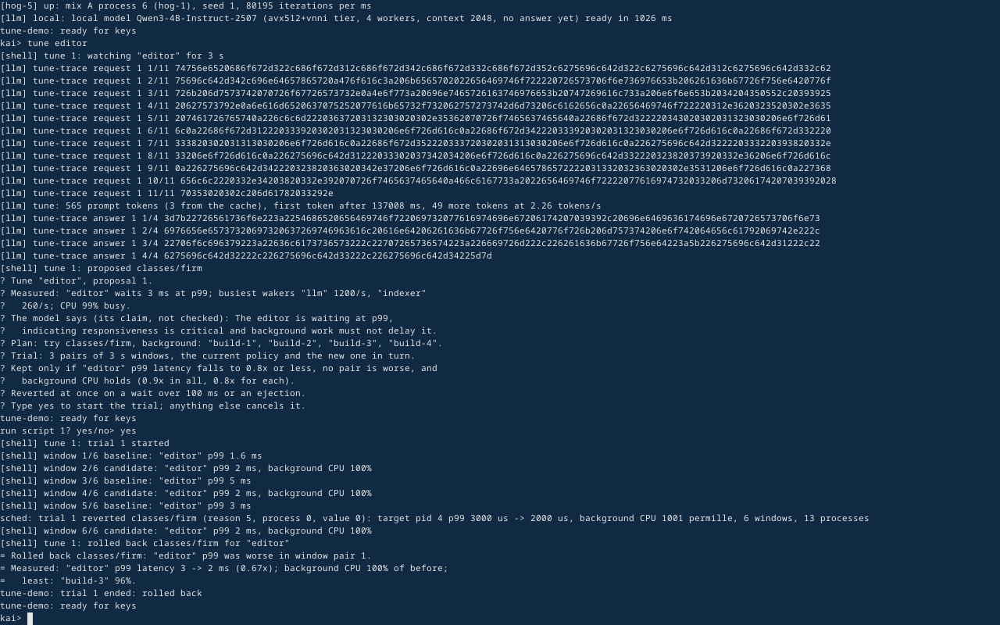

# Kernel AI

**An operating system with a local AI built in.** Kernel AI is a from-scratch x86_64 OS written in Rust. A language model (Qwen3-4B) runs inside the OS, on the CPU, through our own inference engine. There is no cloud and no external server. You talk to the system at one prompt, `kai>`, and the model can answer questions, write scripts that act on the system, and tune the scheduler.



*An early `tune editor` run. The model proposes a policy and explains why. The OS asks before it runs a trial, measures the result, and rolls the change back by itself when a guard fails.*

## What it does

- **One prompt for everything.** The shell is a REPL. Built-in commands, scripts in [Rhai](https://rhai.rs) and plain English all go to `kai>`.
- **The AI acts, within limits.** Plain-English requests become scripts. The OS parses each script again and shows it to you. A script that only reads runs at once; one that changes anything runs only after you type yes. Every script is logged.
- **The AI tunes the OS.** `tune` lets the model choose a scheduler policy for a program. The kernel runs it as a measured trial with guardrails and reverts it on any regression. The model never sits in the scheduling path. This is milestone M10, and it passes its exit test: across 5 seeds the editor's p99 latency fell to 0.44-0.67x of the default's, with background work unharmed.
- **Live-editable, as in TempleOS.** User-mode components carry their own source. A component edited in the OS rebuilds and reloads without a reboot, keeps its state, and rolls back by itself if the new version breaks. Faults and stack frames point to source lines.
- **Our own engine.** The GGUF reader, tokenizer, quantised kernels (AVX2, AVX-512, VNNI) and Qwen3 forward pass are written for this project. Every SIMD tier is tested to give the same bits as the plain one.

## Status

Kernel AI is a **proof of concept**, complete through milestone M10. It runs in a VM only (QEMU or VirtualBox). It has no GUI, no browser, no writable disk and no real-hardware drivers yet.

The next goal is a production-grade OS people have a reason to use, with the local AI able to operate everything in it. That plan is the [product roadmap](docs/roadmap.md#3b-product-roadmap-draft-for-founder-approval-2026-10-20): a desktop, files, networking, existing apps and real hardware. It is a draft and a multi-year program.

## Try it

### Requirements

- **CPU:** x86_64 with AVX2, FMA and F16C (most PCs from the last ten years). AVX-512 is used when present.
- **RAM:** 8 GB or more for Qwen3-4B (the VM gets about 3.5-6 GB). With 4 GB, `setup` offers the smaller Qwen3-1.7B.
- **Disk:** about 2.5 GB for the model, plus a few GB for the build.
- **Software:** Rust through [rustup](https://rustup.rs) (the pinned nightly in `rust-toolchain.toml` installs itself), `curl` and `tar`, and either VirtualBox 7 or QEMU with OVMF.

The tooling is developed on Windows; the QEMU path also runs on Linux. First, check your PC. This changes nothing; it prints a ✓ or ✗ for each requirement, the fix for each ✗, and the path it recommends:

```bash
cargo xtask doctor
```

Then download the model. `setup` recommends the largest model your RAM can run, asks, downloads it with resume and checks its SHA-256:

```bash
cargo xtask setup
```

### VirtualBox (simplest on Windows)

```bash
cargo xtask vbox            # build the release kernel and its boot disk; create or update the VM "Kernel AI"
cargo xtask vbox --start    # boot it in a VirtualBox window (--start --headless for none)
```

The VM is EFI with NVMe disks: one for the OS, one for the model, which is read in place and never copied, so keep the model store on the same drive as the VM folder (`KAI_VBOX_DIR`). Power the VM off before running `cargo xtask vbox` again. `--name NAME` makes a separate VM, and nothing else in VirtualBox is touched. Input is a USB keyboard and tablet on the VM's xHCI controller, so the pointer moves in and out of the window without being captured (no Right Ctrl). The xHCI controller is in VirtualBox's base package since 7.0, so no Extension Pack is needed; `:mouse` at the terminal shows the last pointer report. On a Ryzen 7 7700X with 8 vCPUs the model loads in 5-10 s and answers at 11-12 tokens/s.

### QEMU

QEMU needs a hardware accelerator to be usable with the model: KVM on Linux, KVM inside WSL2 on Windows (what CI uses), or WHPX. `cargo xtask doctor` says which you have and the steps for the rest. Then, for example:

```bash
cargo xtask run --accel kvm --local qwen3-4b-2507   # Linux
cargo xtask run --accel wsl --local qwen3-4b-2507   # Windows, QEMU in WSL2
cargo xtask run --accel kvm --local qwen3-4b-2507 --workload A   # with the demo workload for `tune editor`
```

### Things to type at `kai>`

| Type | What happens |
|---|---|
| `help` and `:help` | The commands and the terminal's own `:` commands. |
| `show me the cpus please` | The model writes a read-only script; it is shown and runs at once. |
| `ask What does an operating system kernel do?` | The local model answers. |
| `:model` | The model, its CPU tier, and one timed prompt with tokens/s. |
| `let x = 6; fn sq(n) { n * n }; sq(x)` | Rhai, run directly. |
| `threads`, `policy`, `ps`, `mem` | Scheduler statistics, the current policy, services, memory. |
| `tune editor` | With `--workload A`: the model proposes a scheduler change, you type yes, the kernel trials it. `tune undo` reverts. |

With no model attached, everything except the AI works, and `:setup` prints the steps.

## How it's built

The kernel boots through Limine on UEFI. Services, the shell and the model run in ring 3 under a supervisor that restarts them when they crash. xtask builds everything and drives QEMU and VirtualBox.

| Path | What it is |
|---|---|
| `kernel/` | The kernel: memory, interrupts, SMP scheduler, virtio and NVMe drivers, syscalls, terminal. |
| `user/` | Ring-3 programs, including the `llm` service that runs the model. |
| `xtask/` | Host tool: build, run, boot tests, model setup, benchmarks, `doctor`, `vbox`, `tune`. |
| `gguf/`, `bpe/`, `quant/`, `infer/`, `cpufeat/` | The inference engine: model files, tokenizer, quantised SIMD kernels, Qwen3 forward pass, CPU features. |
| `shellcore/`, `termcore/`, `llmproto/` | The shell and its AI script path, terminal logic, the protocol to the `llm` service. |
| `sched/`, `mm/` | Scheduler policies, watchdog and simulator; memory and reclaim logic. |
| `livecore/`, `wasmhost/`, `compsdk/`, `components/`, `editcore/` | Live-editable WebAssembly components and the edit loop. |
| `supervise/`, `kabi/`, `uelf/`, `nvme/`, `acpitables/`, `linetable/` | Supervisor, kernel ABI, ELF loading, NVMe, ACPI, address-to-source tables. |

Most logic lives in `no_std` crates with host unit tests. CI ([.github/workflows](.github/workflows)) runs format, lint and those tests, then boots the kernel in QEMU under both KVM and TCG for every boot case. The cases cover faults, timers, scheduling latency, SMP storms, live edits, and the model path on generated test models. Separate workflows run the 10-minute soak, the deterministic (icount) A/B test of `tune`, and real-model jobs.

```bash
cargo xtask test --accel kvm   # every boot case (Linux or WSL2), as CI runs them
cargo xtask soak               # the 10-minute spawn/exit/sleep storm
cargo xtask bench quant        # the engine's speed on this CPU
cargo xtask model chat "What does an operating system kernel do?"   # the engine on the host, no VM
```

More:

- [docs/roadmap.md](docs/roadmap.md): what is built, milestone by milestone, and the product roadmap.
- [docs/decisions.md](docs/decisions.md): design decisions, settled and open.
- [docs/research/](docs/research/): the research behind them.

## Licence

Kernel AI is under the [Mozilla Public License 2.0](LICENSE) (ADR [0009](docs/adr/0009-licence.md)). `kabi/`, `compsdk/` and the interfaces under `wit/` are `MIT OR Apache-2.0`, so programs written for Kernel AI can compile them in under any licence, and the AI's worked examples (`llmproto/src/examples.rs`) are `0BSD`. What the AI writes for you is yours. Contributions are welcome under the same terms, signed off with the DCO: see [CONTRIBUTING.md](CONTRIBUTING.md), and [SECURITY.md](SECURITY.md) for reporting a vulnerability. Third-party code keeps its own licence, listed in [NOTICES.txt](NOTICES.txt); the models are not bundled and keep theirs (Qwen3: Apache-2.0).
